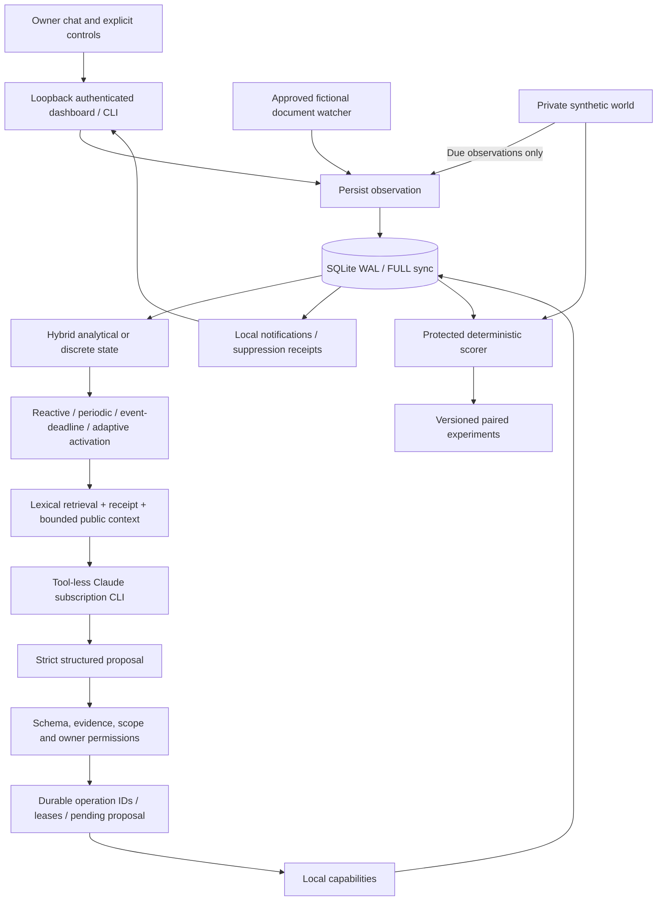

# Architecture

CONTINUUM v0.2 adds `continuum.runtime` and `continuum.research` alongside the unchanged v0.1 scheduler package. The runtime outlives individual model requests; model sessions are ephemeral. SQLite is the authority for goals, observations, beliefs, actions, receipts and controls. The legacy `continuum.__version__` remains 0.1.0 with preserved source; `continuum.runtime.__version__` and distribution metadata identify the 0.2 runtime.

## Persistent flow

An observation is stored before activation. State updates use event time clamped to the monotonic runtime clock; late events retain their original observation timestamps. Retrieval selects nonprivate active assertions with lexical Jaccard scores, a character budget and exclusions. The proposal contains a brief decision summary, typed actions, proposed beliefs, goal updates and a next-delay suggestion. No model text can authorize a capability or become a shell command.

Calls record request hashes, requested/reported main model, safe streaming progress, terminal status and observed usage. Accounting is persisted independently of accepting a proposal, including available failure and cancellation receipts. A response is persisted as a pending proposal before local execution. Durable activation identity prevents a simulated activation from being consumed twice. Recovery reapplies a saved proposal through stable operation IDs; completed effects are skipped. Read operations include a decision revision, allowing fresh data without replaying completed effects. Memory proposal insertion is idempotent by content/provenance; notifications deduplicate content/topic.

Each database has an exclusive OS file lock in addition to SQLite transactions. Queued operations receive a lease when claimed. After exclusive process ownership is regained, formerly running operations are reconciled from artifact receipts/checksums where possible; otherwise their outcome remains unknown. Interrupted inference receipts also become outcome-unknown and pause the runtime. Nothing promises exactly-once effects across an external service. External execution is not enabled.

Explicit stop persists across restarts. `start --resume` or authenticated resume is required to override it. Pause/stop set a cancellation signal outside the model path. Provider process groups belong to this runtime and are terminated on cancellation/deadline; unrelated processes are never enumerated or killed. One runtime executes one deliberation at a time. Project-wide file slots bound CLI inference concurrency to two, and a durable invocation ledger caps it at 2,000 (two early preflight calls preceded this ledger and are recorded separately). The ledger counts CLI invocations, not opaque internal service requests.

## State model

All hand-designed features are normalized to [0,1]; time is in seconds. No parameter is learned. A model may suggest a next consideration delay but cannot directly rewrite state dynamics or permissions.

| Feature | Between-event target | Rate, seconds⁻¹ | Event effect |
|---|---:|---:|---|
| Urgency activation | 1 | 1/300 | Retained diagnostic; exact deadline arithmetic is separate |
| Information staleness | 1 | 1/180 | Reset by relevant evidence or owner message/correction |
| Unresolved uncertainty | 0 | 1/600 | +0.5 on conflict/action failure, capped at 1 |
| Pending pressure | 0 | 0 | Active goals / 5, capped at 1 |
| Interruption cooldown | 0 | 1/30 | Set to 1 after local notification |

For rate λ and baseline b: `s(t+Δ)=b+(s(t)-b)exp(-λΔ)`. Updating only at timestamps is analytically equivalent to stepping continuously between impulses. The discrete control holds features between observations. Permanent memories do not disappear when activation decays.

Runtime elapsed time uses `time.monotonic()` anchored to a persisted wall timestamp. On restart, downtime is clamped to [0,86,400] seconds: backward wall changes add no negative elapsed time; long gaps apply at most one day of decay. This prioritizes stable state over precise civil-time scheduling after a badly changed clock. Deadlines are UTC epoch seconds. Quiet periods are UTC hours. Simulation uses a separate explicitly advanced clock.

## Memory and retention

Distinct types are episode, fact, preference, goal and unresolved question. Assertions carry IDs, provenance IDs, observation/applicable times, confidence, status and optional supersession. Owner controls create confirmed assertions. Model updates remain proposed; a model correction cannot revoke an owner-confirmed belief. Conflicting confirmed assertions are surfaced together rather than overwritten. Explicit corrections supersede old assertions while retaining history.

Forgetting is deliberately conservative: remove the target assertion content, episodic and proposed derived memory, observations/retrieval receipts, derived messages, pending proposals, plans and local artifacts from the run. Preserve minimal IDs/status/timing audit metadata, clear browser event caches via a retention generation, checkpoint WAL and vacuum secure-deleted SQLite pages. Assertions with the same subject or exact content are also purged; unrelated confirmed assertions may remain. This is application-level deletion, not forensic SSD erasure or deletion from an external provider's retention systems. Use fictional or explicitly supplied data only. No embeddings or external memory caches are implemented.

## Boundaries

The approved fixture directory and run artifact directory are separate. A document must be announced before a read; symlinks, traversal and executable output extensions are rejected. Researchers keep scorer labels/future events outside provider context. Public CLI inference has no ambient tools; Continuum exposes only narrow local capabilities.

The local `leo.integration.v1` envelope is an adapter contract, not A2A. A loopback HTTP stub demonstrates validation, cursor persistence and duplicate handling. There is no sibling-project import, real exchange delivery or Leo OS interoperability claim.
