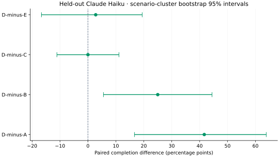
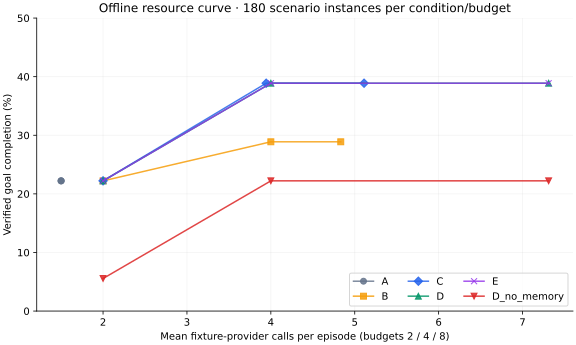

# MORNING REPORT — CONTINUUM v0.2

## Offline failure diagnosis checkpoint — 24 October 2026

Completed one offline diagnosis at `a0ecdd5` on `main`; **no fix implemented**.
All prior telemetry edits remain uncommitted. This section supersedes the earlier
next-task recommendation; the earlier receipts and reports remain below.

- **What failed:** of 32 unsuccessful C/D episodes, 23 produced timely source-linked
  briefs rejected by field parsing, five delivered questions through an unscored
  message path, and four had clarification notifications suppressed despite a
  successful operation receipt. These exclusive proximate mechanisms are demonstrated;
  they do not establish full prose correctness. Unsupported claims and repeated
  questions also occur. **29/32 have no recorded call error.**
- **Comparison:** C/D still score **20/36 each**, using **184/216 calls**. Paired:
  17 both pass, 13 both fail, three wins each. D's extra calls include recovery work;
  no advantage or equivalence is established, interval **−11.11 to +11.11 pp**.
- **Accounting:** campaign `succeeded` means an episode saved, not a correct task.
  All 26 call errors affect 22 episodes, including seven scored successful episodes.
  Usage is missing for **24/844 calls**; historical total cost remains unknown.
- **Verification:** freshly read/re-scored 180 original unit databases plus the
  campaign DB in immutable read-only mode; checked raw results, frozen protocol/source,
  review-packet samples, matched traces and six in-memory scorer probes. The **124
  tests are saved receipts**, hash-checked but not rerun here. Reproducing scores does
  not validate the rubric. Human semantic review and live telemetry remain unverified.
- **One recommended next task:** calibrate the artifact-scoring contract with 12
  manually labeled cases; stop at a reviewed contract and agreed verdicts. Do not
  change historical scores or launch a benchmark. This recommendation is not a launch instruction.

[Detailed diagnosis](evidence/failure-diagnosis-20261024T132605Z/DIAGNOSIS.md)
· [every unsuccessful episode](evidence/failure-diagnosis-20261024T132605Z/FAILED_EPISODES.md)
· [representative timelines](evidence/failure-diagnosis-20261024T132605Z/TIMELINES.md)
· [verification and preservation](evidence/failure-diagnosis-20261024T132605Z/verification.json).
Only the new audit directory and these handoff notes changed in this task; prior
source, tests, frozen/ignored evidence and runtime data were preserved. No external
calls, inference, services, installs, commits or pushes were initiated.

## Continuation review checkpoint — 24 October 2026

The existing implementation was already committed at `a0ecdd5` on `main`; only
`AGENTS.md`, `learning.md` and `decisions.md` were untracked at startup. This
continuation preserves them and all frozen/ignored runtime evidence. Its changes
are **uncommitted**, with no branch changes or pushes.

- **Fresh verification:** baseline 78 runtime + 28 legacy tests passed. Final suite
  is **96 runtime + 28 legacy = 124**, including 18 new telemetry regressions.
  v0.1's 450 runs reproduced byte-identically; all 3,240 final offline episodes
  replayed with identical metrics except wall timing. Compile checks and whitespace
  checks passed. See [validation](evidence/continuation-20261024/validation.json).
- **Independent evidence reconstruction:** all 3,420 offline/live stored episodes
  re-scored, both reports reconstructed exactly, 3,422 database integrity checks
  passed. Live C and D remain **20/36 = 55.56%**; D used **216 vs C's 184 calls**.
  All 844 historical live calls remain counted; 24 lack usage. Total cost is unknown.
  [Reproducible verifier](scripts/verify_stored_evidence.py) · [receipt](evidence/continuation-20261024/stored-evidence.json).
- **One engineering change:** additive provider-attempt accounting in SQLite, with
  stable identities, retry links, explicit failure codes, sanitized usage metadata,
  restart reconciliation and idempotent terminal receipts. Existing `calls` rows
  and frozen results are untouched. Provider success is distinct from later action
  rejection/control discard. The authenticated runtime status includes `telemetry`.
- **Limits:** internal CLI retries are opaque; existing calls without attempt rows
  are explicitly uncovered. No historical costs were backfilled. New instrumentation
  is fixture-tested, not live-verified. Browser/demo/600-second-soak receipts were
  located but those checks were not repeated. Human review remains incomplete.
- **Scope:** no external network requests, live provider runs, paid benchmarks,
  integrations, installs, persistent services, commits or pushes. Codex remains gated.

Read [learning.md](learning.md) for commands, experiments, failures and evidence;
[decisions.md](decisions.md) for architecture, tradeoffs and revisit conditions.
**Next:** review this diff and migration evidence, then independently review the
existing C/D human-review packet before considering broader evaluation.

The original 20 October report follows. Its Git state, live availability and service
status are historical statements, superseded by the checkpoint above.

Built on the existing v0.1 simulator, with source/results preserved and no Git commit. The deliverable is a restartable local runtime with real Claude-backed chat/document work, explicit memory and owner controls, plus a frozen synthetic experimental platform. It is not production-ready or a demonstration of consciousness or general long-horizon intelligence.

## Delivery and evidence

- **Baseline preserved:** readable 21-file snapshot includes untracked files; hashes and restore instructions are in `preserved/v0.1/`. Original simulator source/tests/results and OVERNIGHT_REPORT are unchanged. The empty Git history was not a blocker.
- **Tests:** 78 runtime/security/scorer/integration tests and 28 archived simulator tests passed: 106 total. Real Chromium verified desktop/mobile chat, artifact reading, fact correction and pause/resume.
- **Live path:** the three-call, 40.215-second wall-clock demo used exact model `claude-haiku-4-5-20251001`, noticed a new fictional review without a second user message, produced a cited brief and initiated a local clarification.
- **Runtime:** SQLite goals, observations, beliefs, action leases, pending proposals, outbox and recovery checkpoints; monotonic wall-clock execution and separate simulated clocks; analytical/discrete dynamics and explicit activation controls.
- **Control/security:** tool-less structured proposals, narrow local capabilities, strict schema/evidence/permission checks, path confinement, private memory exclusions, conservative forgetting and authenticated loopback controls. Unknown effects are not blindly replayed.
- **Integrations:** project-local envelope/HTTP stub and read-only APIs are implemented. There is no actual Leo OS or Agent Exchange integration, no A2A/MCP implementation and no external messaging/payment/executable-code capability.

## Held-out live result

Completed **180/180** declared episodes: 18 scenario instances across six templates, two stochastic repetitions and five policies, six-call ceiling per episode. Fixed primary model: `claude-haiku-4-5-20251001`. The observed first-call-to-last-result window was **68.2 minutes**; model service time did not advance virtual world deadlines.

| Policy | Episodes | Completion, all attempted | Valid-only completion | Pooled intervention precision | Pooled recall | Mean calls |
|---|---:|---:|---:|---:|---:|---:|
| A · Reactive + memory | 36 | 13.89% | 14.71% | 100.00% | 8.82% | 1.50 |
| B · Periodic + memory | 36 | 30.56% | 39.29% | 29.03% | 26.47% | 4.83 |
| C · Event/deadline baseline | 36 | 55.56% | 55.88% | 56.25% | 52.94% | 5.11 |
| D · Hybrid continuous state | 36 | 55.56% | 54.84% | 58.06% | 52.94% | 6.00 |
| E · D schedule, state withheld | 36 | 52.78% | 51.61% | 56.67% | 50.00% | 6.00 |

| Paired difference | Mean | 95% scenario-cluster bootstrap interval |
|---|---:|---:|
| D minus A | +41.67 pp | [+16.67, +63.89] pp |
| D minus B | +25.00 pp | [+5.56, +44.44] pp |
| D minus C | +0.00 pp | [-11.11, +11.11] pp |
| D minus E | +2.78 pp | [-16.67, +19.44] pp |

These comparisons apply to the declared six handcrafted templates. Scenario clusters, not individual model calls, define the uncertainty calculation. Repetitions are averaged within each scenario. A tie or interval spanning zero is not evidence of equivalence. Wider real-world claims are unsupported.

**Central finding:** D completed 20/36 episodes (55.56%); C completed 20/36 (55.56%). D used 6.00 invocations per episode versus C's 5.11. D minus C was +0.00 percentage points with a 95% interval of [-11.11, +11.11]. D minus the state-withheld E control was +2.78 points [-16.67, +19.44]. These results do not establish an added benefit from the continuous-state mechanism.

Losses remain visible: D completed 33.33% of memory-revision episodes versus C's 50%; E outperformed D on delayed dependencies and deadline/follow-up tasks. D performed better than C on document updates. Each family has only six live episodes per policy, so these are descriptive failure-analysis signals.

[Full family results, latency, interruptions, supported-field accuracy and failure analysis](experiments/v02/live-heldout-v1/ANALYSIS.md). [Raw per-unit results](experiments/v02/live-heldout-v1/results.jsonl). [Frozen protocol/source](experiments/v02/live-heldout-v1/protocol.json).



## Failures, costs and interpretation

Observed provider failure categories: `{"['Failed to provide valid structured output after 5 attempts']": 4, "unexpected ambient tool request": 20, "unsupported goal update": 2}`. All attempted episodes remain in the primary denominator. Conditional-on-valid-execution results are labelled separately. **36/36** realized D/E call schedules matched in this campaign; exact paired call times are retained in `failure-analysis.json`.

Precision/recall opportunities were fixed before inference. The scorer requires timely local effects, current source references, exact supported Status/Risk fields and a real Markdown table where requested. It does not certify every natural-language assertion. Clarification uses a narrow predefined rubric. Human-review packets contain both successes and failures and remain **AWAITING INDEPENDENT HUMAN REVIEW**.

| Policy | Aggregate known API-equivalent USD subtotal | Complete total USD estimate | USD / verified outcome, all attempts | Token telemetry complete? |
|---|---:|---:|---:|---|
| A | 0.564 | unknown | unknown | no |
| B | 1.875 | unknown | unknown | no |
| C | 2.564 | unknown | unknown | no |
| D | 2.776 | unknown | unknown | no |
| E | 2.634 | unknown | unknown | no |

Known subtotals exclude episodes with incomplete telemetry and are not total spend. The frozen adapter discarded terminal-error usage and usage from responses discarded after a control change. Some missing telemetry is therefore an instrumentation defect, not necessarily missing provider telemetry. These records cannot be reliably reconstructed; no failed trial was rerun to backfill them. The post-campaign repair retains available error/cancellation usage and was regression-tested; the frozen source and outcomes remain unchanged.

Missing usage, rate dates and actual subscription charges remain null. CLI-reported API-equivalent estimates are not invoices. Per-model token rows, including auxiliary CLI work, are aggregated once; primary usage is retained separately. A recorded call is one CLI invocation, which may contain multiple internal inference requests or retries. The parent coding session was not metered here. Build receipts are separate from agent-run receipts.

The repaired adapter passed a fresh exact-model live preflight in **5.727 seconds**, with no cleanup warnings. The completed-campaign resume check made **zero new calls** and preserved the raw-results SHA256. [Repair receipt](evidence/build/accounting-repair-applied.json) · [Live preflight](evidence/build/post-campaign-preflight.json) · [Resume check](evidence/build/completed-resume.json).

## Offline resource and ablation result

The final fixture matrix completed and replayed **3,240/3,240** episodes: 30 seeds × six families × six conditions × budgets 2/4/8. At budget 4, completion was A 22.22%, B 28.89%, C/D/E 38.89%, and D with lexical retrieval removed 22.22%. Observation history remains in that memory ablation. Equal ingestion across policies does not demonstrate a scheduler memory advantage.

At budget 8, C and D again tied at 38.89%, while mean calls were 5.111 and 7.311. D and E matched every final offline call schedule. The fixture policy does not use state features to choose action content, so this state-ablation tie is an expected control, not proof that state features cannot help an LLM.



The preserved v0.1 results reproduce: adaptive 94.21%, reactive 82.93%, periodic 73.58% across 450 runs. An independent exploratory idle-activation ablation preserved all 150 adaptive action outcomes while reducing decisions 7,969→7,402 and synthetic cost 2,494.2→2,437.5. That weakens a causal interpretation of its decaying-state mechanism. v0.1 and v0.2 use different workloads and metrics; their completion percentages are not a direct progress comparison.

## Pilot findings, reliability and routing

- Pilot-v1 exposed a tool-receipt wake-up defect; a waiting goal could fail to continue after a read. It was repaired and regression-tested. Its original source and 30 outcomes remain intact.
- Pilot-v2 retained a 180,000-byte stream cap and produced three output-bound failures, one model-slot failure and one rejected unexpected tool request. The final one-million-byte bound addresses framing overhead while retaining a real hard limit. No failed pilot was relabelled as a successful repaired run.
- Independent review repaired model-dependent skip gates in the exact-schedule ablation, false-positive table scoring, stale-field accounting and failed-episode pooled denominators before held-out execution.
- The routing development check had six trials: valid responses 1/2 fixed Haiku, 2/2 fixed Sonnet and 2/2 router; the narrow exact-colon-field artifact check passed 0/2, 0/2 and 1/2 respectively. This small operational check cannot establish router superiority or broad model quality.
- The proposal-only improvement copy changed reflection 30→60 seconds on three development fixture scenarios. Completion stayed 2/3 and calls 22→19. The diff is queued, **not applied**; promotion requires fresh evaluation and human review.

The final wall-clock fixture soak lasted **600.013 seconds**, with 30 fixture deliberations, 1 artifact(s) and 1 locally available notification(s). Pause, resume, joined shutdown and restart-retained stop were observed. This is a ten-minute local fixture test, not a multi-day live-model run. The earlier 120.035-second soak is also retained.

## Boundaries and outstanding work

All implementation/source changes are in this repository and left uncommitted on the existing main branch. No branch, worktree, commit, push, deployment, sibling import/edit, real third-party message, payment or separately billed API was used. Repository-local environments and caches were used. One coordinator wrote source; independent readers wrote isolated review receipts; model concurrency was bounded to two.

**Outstanding permissions: none for the delivered local scope.** Codex inference is disabled because complete ambient-tool isolation is NOT VERIFIED; ChatGPT authentication alone is insufficient. The exact failed isolation preflight is in `evidence/build/codex-preflight.json`. No weaker isolation or API billing fallback was used. External integrations/payments, production deployment and automatic improvement promotion remain unimplemented/unauthorized.

Known limits include narrow synthetic templates, virtual deadlines, short real soak, lexical-only retrieval, unconfirmed model-proposed beliefs, partial prose scoring, optional/null distributed-tracing fields, best-effort secret redaction, no database encryption and no forensic/provider-side deletion guarantee. No physical power-loss or actual disk-exhaustion test was performed. The baseline source retains its original out-of-horizon feasibility edge and test connection ResourceWarning; stock benchmark results are unaffected.

## Start, verify and inspect

These are historical operational commands, not current authorization to launch.
For this review, use `scripts/verify_stored_evidence.py`; the old `report`, `resume`
and `analyze` commands can write into frozen campaign directories.

```sh
.venv/bin/python -m continuum.runtime start --directory .runtime/live --provider claude --model claude-haiku-4-5-20251001
.venv/bin/python -m continuum.runtime status --directory .runtime/live
.venv/bin/python -m continuum.runtime pause --directory .runtime/live
.venv/bin/python -m continuum.runtime resume --directory .runtime/live
.venv/bin/python -m continuum.runtime stop --directory .runtime/live
.venv/bin/python -m unittest discover -s tests_runtime -v
.venv/bin/python scripts/reproduce.py v01
.venv/bin/python scripts/reproduce.py experiments/v02/offline-final-v2
.venv/bin/python -m continuum.research.campaign resume --directory experiments/v02/live-heldout-v1
.venv/bin/python scripts/analyze.py --directory experiments/v02/live-heldout-v1
.venv/bin/python scripts/plot_results.py
```

Start is a foreground server; use a second terminal for controls. Stop persists and exits it; explicitly use `start ... --resume` to resume after restart. A completed campaign resume makes no new model calls, including after the telemetry repair. Source drift remains rejected if unfinished experimental units would execute. See README for initial dependency setup and browser checks.

**Historical next-step suggestion (superseded by the review checkpoint above):** open the local dashboard and review the example brief, memory correction history and failed-trial evidence. The build stops here; no further scope expansion or automatic promotion is queued.
