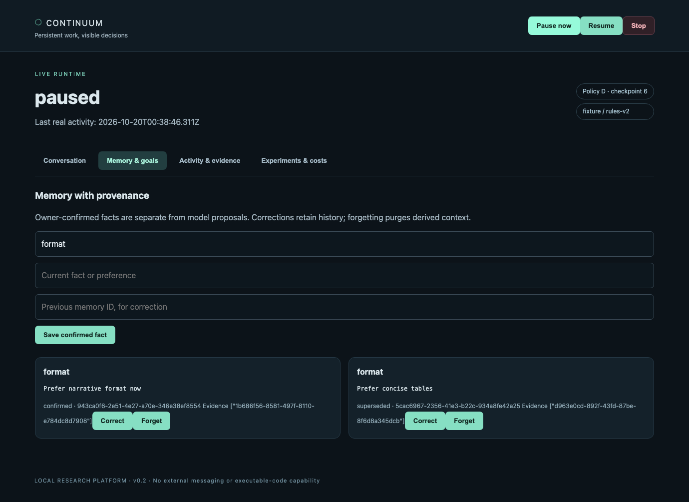
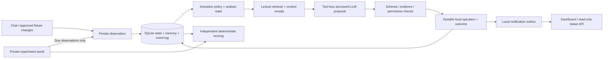

# CONTINUUM

**Persistent work, visible decisions.** A local Python agent that retains goals and evidence across model calls, notices approved document changes, proposes work, and leaves inspectable receipts for every action.

A reactive chat session stops at the end of a reply. CONTINUUM separates the lifetime of the **runtime** from the lifetime of an **LLM request**: SQLite holds the work; activation policies decide when to reconsider it; a tool-less model proposes actions; deterministic code enforces scope and owner control.

**Working live demo:** Claude Haiku noticed a newly available fictional project review, produced a source-backed readiness brief and asked a necessary owner clarification without another user message: **3 model calls, 40.2 seconds of real elapsed time**. [Generated brief](experiments/v02/live-runtime-demo-v1/agent/artifacts/juniper_readiness_brief.md) · [demo receipt](experiments/v02/live-runtime-demo-v1/receipt.json). This is a bounded local demonstration, not evidence of general long-horizon intelligence.

**Measured result:** across **180 live Claude-backed synthetic episodes**, the hybrid agent and the strong event/deadline baseline both completed **55.56%** of tasks. The hybrid used **6.00 vs 5.11 CLI invocations per episode**; their paired completion difference was **0 percentage points, 95% interval [−11.11, +11.11]**. This experiment does **not establish a continuous-state advantage**. [Results, losses and limits](MORNING_REPORT.md) · [frozen protocol](EXPERIMENT_PROTOCOL.md).

**Original build verification:** 106 passing tests, 3,240 reproducible offline episodes, real Chromium desktop/mobile checks, and a 600-second wall-clock fixture soak. The original v0.1 benchmark reproduces byte-for-byte. Live experiments use fictional worlds and virtual deadlines; they do not demonstrate general real-world autonomy. Frozen error telemetry is incomplete, so total cost remains unknown.

**24 October continuation:** 124 offline tests pass; stored results were independently re-scored and offline campaigns replayed. New per-attempt telemetry preserves failure/cost coverage without backfilling historical unknowns. Start a new engineering session with [learning.md](learning.md), [decisions.md](decisions.md) and the current [handoff](MORNING_REPORT.md). No new live verification was performed.



## Run it locally

Python 3.11+ on macOS/Linux. Dependencies, caches, data and artifacts remain inside this repository. No API key is required for the fixture demo.

```sh
python3 -m venv .venv
mkdir -p .cache/pip .cache/tmp
PIP_CACHE_DIR="$PWD/.cache/pip" .venv/bin/python -m pip install -r requirements-runtime.txt
.venv/bin/python -m continuum.runtime start --directory .runtime/owner --provider fixture
```

Open **http://127.0.0.1:8787**. Enter the token from `.runtime/owner/control-token` in the local login form. The fixture provider exercises plumbing with deterministic rules; it is not an LLM.

For the verified subscription path, use an existing Claude Code login:

```sh
.venv/bin/python -m continuum.runtime start --directory .runtime/live \
  --provider claude --model claude-haiku-4-5-20251001 --port 8787 \
  --quiet-hours 22,23,0,1,2,3,4,5,6 --interruption-budget 8
```

A live provider receives selected conversation and approved source context. Notifications are delivered only to this local interface. Start with fictional data. Claude authentication is checked without reading login secrets; API-key environments are stripped. Codex inference is **disabled / NOT VERIFIED**, with the exact isolation blocker documented in [MODEL_SUPPORT.md](MODEL_SUPPORT.md).

In a second terminal, using the same directory/port as the server:

```sh
.venv/bin/python -m continuum.runtime status --directory .runtime/live
.venv/bin/python -m continuum.runtime goal --directory .runtime/live \
  'Monitor the fictional project and create a source-backed readiness brief when a review arrives.'
.venv/bin/python -m continuum.runtime message --directory .runtime/live \
  'Use only the approved fictional documents and ask about unresolved owner decisions.'
.venv/bin/python -m continuum.runtime fact --directory .runtime/live format 'Prefer concise tables'
.venv/bin/python -m continuum.runtime pause --directory .runtime/live
.venv/bin/python -m continuum.runtime resume --directory .runtime/live
.venv/bin/python -m continuum.runtime events --directory .runtime/live
.venv/bin/python -m continuum.runtime stop --directory .runtime/live
```

The dashboard also supports fact correction with provenance, forgetting, goal cancellation, muting, concrete action approval and artifact reading. Add/update a fictional `.md` file in `fixtures/documents/` to trigger the approved watcher. Use `--fixtures` for a different **repository-local** folder. Stop exits the server and persists the stop; restarting requires `start ... --resume` to explicitly continue. Do not run two owners on the same runtime directory.

## How it works



The continuous-time model is an interpretable hybrid system: analytic exponential evolution between event impulses. Timestamp-only updates are mathematically equivalent to continuously stepping that equation. Faster polling is not additional cognition. Memory contents persist independently of activation-score decay.

Operations use stable IDs, transactions, leases, checkpoint versions and an outbox. Restart reconciliation distinguishes completed effects from **outcome-unknown** work. Unknown inference outcomes pause recovery instead of being blindly resent. Owner pause, stop and revocation bypass the model. See [ARCHITECTURE.md](ARCHITECTURE.md) and [SECURITY.md](SECURITY.md).

## What is actually verified

| Capability | Evidence level |
|---|---|
| Persistent goals, memory revisions, lexical receipts, restart/control handling | Implemented and locally tested |
| Chat, own-message history, artifact reading, correction, pause/resume, mobile layout | Real Chromium smoke tested |
| Claude structured proposals and autonomous local document work | Live verified with installed subscription CLI |
| A/B/C/D/E policies and separate retrieval ablation | Versioned synthetic experiments; limited causal scope |
| Local exchange envelope, deduplication/cursor and HTTP adapter | Tested against a local stub; no cross-project interoperability claim |
| Rule-based model routing | Operational adapter plus separate small development comparison |
| Improvement cycle | Candidate configuration evaluated; diff queued; never self-applied |
| Codex inference, embeddings, A2A/MCP integration, payments, matchmaking | Unverified or unimplemented; [future research](FUTURE_RESEARCH.md) |

## Reproduce the evidence

```sh
# Original simulator: unchanged source/results, 28 tests and 450 runs
.venv/bin/python scripts/reproduce.py v01

# Runtime, security, scorer, HTTP integration and failure tests
.venv/bin/python -m unittest discover -s tests_runtime -v

# Regenerate a frozen offline campaign in a disposable repository-local copy
.venv/bin/python scripts/reproduce.py experiments/v02/offline-final-v2

# New offline campaign: never reuse/overwrite an existing frozen directory
.venv/bin/python -m continuum.research.campaign freeze --directory experiments/v02/my-offline
.venv/bin/python -m continuum.research.campaign run --directory experiments/v02/my-offline
.venv/bin/python -m continuum.research.campaign resume --directory experiments/v02/my-offline
.venv/bin/python -m continuum.research.campaign report --directory experiments/v02/my-offline

# Actual wall-clock soak; fixture provider, finite limit, not simulated days
.venv/bin/python scripts/soak.py --seconds 120
```

Live campaign commands, budgets and resume rules are in [EXPERIMENT_PROTOCOL.md](EXPERIMENT_PROTOCOL.md). A repeated model call is a new trial, never deterministic replay. Source drift blocks unfinished execution; a completed campaign can regenerate its report without new inference. Completed experimental units are not rerun.

For browser checks, install repository-local development dependencies and Chromium, start a fixture server in one terminal, then run the smoke command in another:

```sh
PIP_CACHE_DIR="$PWD/.cache/pip" .venv/bin/python -m pip install -r requirements-dev.txt
PLAYWRIGHT_BROWSERS_PATH="$PWD/.cache/ms-playwright" .venv/bin/python -m playwright install chromium
.venv/bin/python -m continuum.runtime start --directory .runtime/browser-check --port 8789 --seconds 180
# In another terminal:
PLAYWRIGHT_BROWSERS_PATH="$PWD/.cache/ms-playwright" .venv/bin/python scripts/browser_smoke.py \
  --port 8789 --directory .runtime/browser-check
```

[Test evidence](TEST_REPORT.md) includes failure cases and known limits. The original [OVERNIGHT_REPORT.md](OVERNIGHT_REPORT.md), [raw v0.1 results](results/) and [recoverable untracked-source snapshot](preserved/v0.1/RESTORE.md) remain available; no commit was required to preserve the baseline.


Offline fixture results: D and E coincide; C reaches the same completion with fewer calls at the higher budget. These curves describe the declared synthetic task/rule combination.

## Engineering demonstrated

- **AI engineering:** strict proposals, context selection, model identity checks, bounded streaming adapters, inspectable routing and tool permissions.
- **Python and databases:** typed interfaces, analytical state dynamics, SQLite transactions, leases, event logs, recovery and durable ownership.
- **Experimental methods:** paired conditions, schedule/state/retrieval ablations, hidden scorer data, frozen manifests, clustered uncertainty and published losses.
- **Reliability and security:** failure injection, cancellation, unknown outcomes, path confinement, provenance, retention, authenticated same-origin controls and real browser testing.
- **Long-horizon autonomy:** durable goals, event-driven continuation and proactive local communication, with measured interruptions and explicit limits.

The six workloads are narrow synthetic templates with 120-second virtual horizons. Model service time does not advance those virtual deadlines; provider elapsed time is logged separately. Structured-field scoring does not certify unrestricted prose factuality; the real wall-clock soak is short. There is no production-readiness, consciousness, continuous neural inference or self-preservation claim. Actual subscription charges are unknown; API-equivalent estimates are labelled separately.
