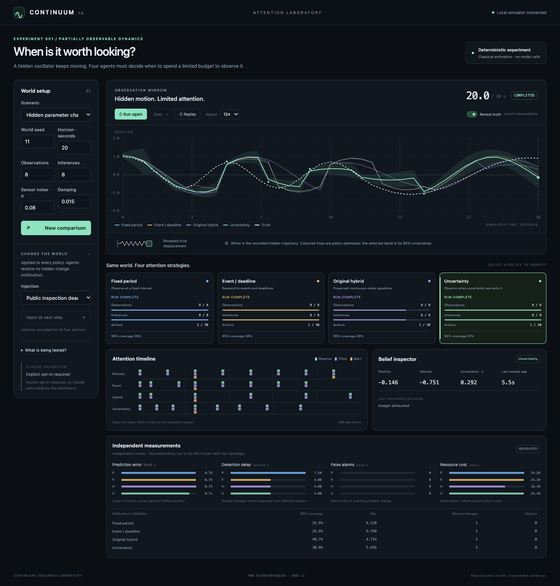

# Continuum 1.0 — Attention Laboratory

**When is it worth looking?** A hidden oscillator keeps moving while four agents decide when to spend limited observations and numerical inference. Continuum measures whether better attention scheduling produces better predictions, earlier detection, and fewer false alarms.

This is a focused research laboratory. Agent Exchange and LeoOS are independent projects. The laboratory does not connect to either.

**Strongest historical failed hypothesis:** the original hand-designed continuous-state hybrid demonstrated **no completion advantage** over the event/deadline baseline: both completed **55.56%** across 180 live episodes, while the hybrid used **6.00 vs 5.11 CLI invocations**. The paired difference was **0 percentage points**, reported 95% interval **[−11.11, +11.11]**. [Original results and limitations](MORNING_REPORT.md), [frozen original protocol](EXPERIMENT_PROTOCOL.md).

**Strongest new result:** in 384 frozen held-out oscillator runs, the uncertainty heuristic had worse mean RMSE (**0.3135**) than fixed-period (**0.2700**), event/deadline (**0.2620**) and the hybrid adaptation (**0.2521**). Its paired RMSE excess over fixed-period was **+0.0434**, descriptive 95% interval **[0.0331, 0.0552]**. All 384 traces and scores reproduce exactly. The proposed uncertainty advantage failed under this protocol. [Exact results, calibration, misses and failures](docs/RESULTS_V1.md). No novelty or general agent-intelligence claim is made. [Related research](docs/RELATED_WORK.md) covers SentinelBench, active sensing/POMDPs, variance-triggered estimation, proactive triggering, and budget-aware tools.

## Run the laboratory

Python 3.11+, the existing Python environment, SQLite, and a browser are sufficient. No Claude subscription is needed for the experiment or comparisons.

```sh
# If the local environment does not already exist:
python3 -m venv .venv
.venv/bin/python -m pip install -r requirements-runtime.txt

# Default experience: the physical attention laboratory
.venv/bin/python -m continuum
# Open http://127.0.0.1:8787

# One reproducible comparison, without the browser
.venv/bin/python -m continuum compare --scenario change --seed 7 --budget 24
```

Press **Run**. Coloured lines show each policy's estimate; shaded bands show estimated uncertainty. Gaps between observations are sleep. After the run, reveal the real trajectory and compare independent scores. Click timeline marks for actual operation receipts. The same screen supports pause, step, replay, budgets, noise, damping, and public-event or hidden-parameter injection. Interactive injections are exploratory, outside the frozen evaluation.



State persists in `.runtime/lab/`. A restart restores the latest checkpoint, paused. New comparisons and replays create new databases; they do not overwrite past runs. The server accepts only loopback, same-origin controls. No frontend framework or new frontend dependency is required.

## What is measured

The private world follows `x'' + 2γx' + ω²x = 0`, with exact analytical transitions and hidden changes in frequency/damping. Time is simulated, independent of render speed or wall time. The seed determines world changes and the sensor's noise at each timestamp, independently of observation order.

All schedulers share the same classical two-state Kalman estimator, nominal physical model, sensor noise, detector, budget caps, and scoring grid. A policy receives only its immutable public clock, belief, remaining budgets, authorised observations and public event/deadline information. Hidden changes do not emit free notifications. This is an API information boundary for trusted research policies, not a sandbox against malicious Python introspection.

| Policy | Scheduling rule |
|---|---|
| Fixed period | Regular sampling, with cadence selected on development seeds |
| Event / deadline | Public events and explicit deadlines plus periodic fallback |
| Original hybrid | Oscillator adaptation of the preserved v0.2 continuous-state equations and scheduling rule |
| Uncertainty aware | Greedy expected variance-reduction proxy with budget pacing; VOI-inspired, not optimal VOI |

Predictions are scored one simulated second ahead at every half-second tick, including sleep. Primary outcome is episode RMSE. Secondary outcomes include Gaussian negative log likelihood, 95% interval coverage, conditional and miss-censored detection delay, missed changes, false alarms, resource use, rejected operations and runtime failures. A zero-position predictor provides a reference for natural amplitude decay. Observation, measurement-update and alert costs are separately counted; total declared cost is `observations + 2 × updates + 0.1 × alerts`.

Cheap shared covariance propagation and forecast arithmetic are fixed numerical bookkeeping; **paid inference means a measurement update**, not an LLM call. Deterministic runs make **zero model calls**. Forecasts never incorporate future measurements. Old timestamps are rejected, gross contradictory readings are recorded/rejected, and failed operations remain failed. Gaussian intervals may be poorly calibrated after model changes; coverage is measured rather than assumed.

## Reproduce and verify

**Verified:** 167 tests (51 laboratory, 88 runtime, 28 legacy); nine real-browser acceptance checks on desktop/mobile; exact historical and held-out reproduction. [Acceptance evidence](docs/ACCEPTANCE_V1.md).

```sh
TMPDIR="$PWD/.cache/tmp" .venv/bin/python -m unittest discover -s tests_lab -v
TMPDIR="$PWD/.cache/tmp" .venv/bin/python -m unittest discover -s tests_runtime -v
TMPDIR="$PWD/.cache/tmp" .venv/bin/python -m unittest discover -s tests -v

# Reproduce every final score and complete trace without rewriting evidence
.venv/bin/python -m continuum.lab.campaign verify --directory experiments/v1/heldout-001 --reproduce

# Historical v0.1 source and results reproduce without overwriting originals
.venv/bin/python scripts/reproduce.py v01
```

The [Phase 0 audit](docs/REDESIGN_AUDIT.md) records specific keep/replace/retire decisions. All v0.1/v0.2 experiments, manifests, failed-run evidence, original reports and archived source remain in place. [Pre-redesign snapshot](preserved/pre-v1/manifest.json) covers the original source and available evidence, including local runtime state; its archive is local evidence and should be reviewed before publication. Historical per-unit SQLite files were not all present in this checkout; missing telemetry remains unknown.

The old assistant executable remains available through `python -m continuum.runtime`, and the original simulator through `python -m continuum demo` / `benchmark` or `continuum-legacy`. They are historical compatibility paths, outside the laboratory's default workflow. The receipt fix also makes old runtime execution messages report actual operation statuses rather than unverified completion prose.

## Live Claude validation

Live inference is separate and requires explicit opt-in. The existing subscription CLI adapter is reused with bounded calls, a wall-clock deadline, exact model identity, strict output validation and no separately billed API fallback. Version/help compatibility is recorded in [the CLI probe](experiments/v1/claude-cli-probe.json); a successful flag probe alone does not establish live inference compatibility.

**Live pilot:** 3/3 valid trigger proposals, zero failures, **51.824 seconds**, exact Haiku model identity verified. Suggested delays were 5, 5 and 10 simulated seconds. [Exact inputs, outputs, usage and limits](docs/LIVE_RESULTS_V1.md).

This small fixed-public-context pilot validates trigger suggestions and receipt accounting. It does not establish a closed-loop Claude scheduling advantage. Its contexts, all attempted calls, failures, usage and model receipts are preserved. Subscription charges are unknown. The deterministic dashboard never silently invokes Claude.

The stopping point is the independently measured oscillator comparison and its evidence-backed dashboard. A learned trigger, new orchestrator, personal assistant, integrations and extra product features are deliberately outside this release.
